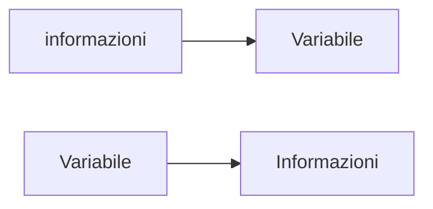
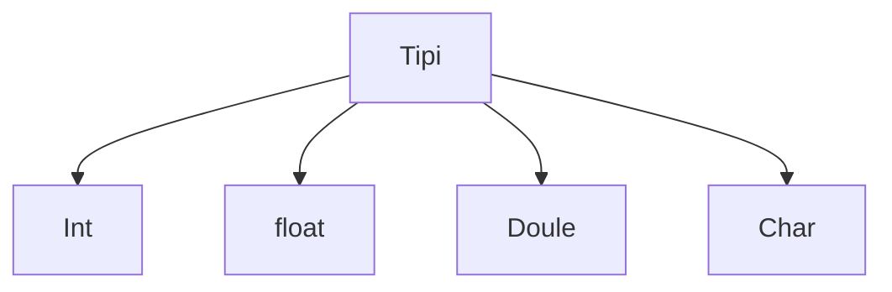

#  Variabili e tipi

<div class="not-prose">
  <aside style="position: sticky; top: 1rem; margin-bottom: 1.5rem; padding: 1rem; border: 1px solid #e2e8f0; border-radius: 12px; background: #f8fafc; max-width: 260px;">
    <p style="margin: 0 0 0.75rem; font-weight: 700; color: #0f172a;">Menu del corso C</p>
    <ul style="list-style: none; padding: 0; margin: 0; display: grid; gap: 0.35rem; font-size: 0.92rem;">
      <li><a href="./intro_c.MD">Introduzione</a></li>
      <li><a href="./page_1.MD">1. Variabili e tipi</a></li>
      <li><a href="./page_2.MD">2. Librerie</a></li>
      <li><a href="./page_3.MD">3. Input/Output</a></li>
      <li><a href="./page_4.MD">4. Operazioni e condizioni</a></li>
      <li><a href="./page_5.MD">5. Cicli</a></li>
      <li><a href="./page_6.MD">6. Funzioni</a></li>
      <li><a href="./page_7.MD">7. Array</a></li>
      <li><a href="./page_8.MD">8. Stringhe</a></li>
      <li><a href="./page_9.MD">9. Puntatori</a></li>
      <li><a href="./page_10.MD">10. Memoria dinamica</a></li>
      <li><a href="./page_11.MD">11. File</a></li>
      <li><a href="./page_12.MD">12. Progetto finale</a></li>
      <li><a href="./page_13.MD">13. Indice conclusivo</a></li>
    </ul>
  </aside>
</div>

## Obiettivi di apprendimento

- capire cos'è una variabile e perché viene usata
- riconoscere i tipi principali di dati in C
- dichiarare e inizializzare variabili correttamente
- imparare a usare commenti e a leggere il codice in modo ordinato

### Cosa sono le variabili?

Le variabili sono delle parole che vengono create all'interno del programma per memorizzare e restituire dati che sono stati elaborati dalla macchina all'utente

> **Inizializzare**: vuol dire nel termine informatico creare una parola che conterrà un certo tipo di informazioni all'interno di una variabile

### Architettura

Questo schema dimostra il flusso che deve fare il programma o la macchina per fare inserire e stampare e le informazioni da terminale all'utente.

### Cosa sono tipi? Quanti c'è ne sono?

Peer rispondere alla domanda vi verrà visualizzato il seguente schema 



Vediamo uno per uno:
- **Int**: numeri interi senza virgola
- **float**: numeri con la virgola o chiamati anche numeri decimali
- **double**: numeri con 2 numeri dopo la virgola
- **char**: considera solo i caratteri come A, B, C, D, ecc...

### Esempi chiari di come inizializzare i tipi e le variabili

```file.c
int miaVariabile;
```

>[!NOTE]
> Quando si inizia a programmare in un file C bisogna sempre mettere un punto e virgola alla fine di ogni riga perchè altrimenti il compilatore vi dà errore di battitura del file.

Ecco come si dichiara una variabile e immaganizzare informazioni non solo in C ma anche negli altri linguaggi di programmazione.

- la prima cosa da fare e dichiarare il tipo di variabile che si vuole acquisire da terminale
- dare un nome a vostra scelta alla variabileche verrà inserito dall'utente.

Altri esempi di inizializzazione delle variabili:

```c
int intero  //Questa variabile acquisisce solo numeri interi
float decimale //Questa variabile acquisisce solo numeri decimali
double decimale2 //Questa variabile acquisisce numeri decimali con 2 cifre dopo la virgola
char carattere //Questa variabile acquisisce solo caratteri
```

### Come si posso commentare del codice all'interno di un qualsiasi file senza che il compilatore lo prenda lo considera codice da eseguire?

Se si vuole commentare del codice che magari per scrivere la logica di funzionamento o come si comporta quel pezzo di codice allora si utilizza i due slash **/ /** per commentare in una sola riga, ma se volete commentare su più righe se volete spiegare e dovete fare uno spiegone alle si utilizza <strong>/* */</strong>. Vi do altro esempio che si usa per scrivere più righe:

```c
/**
 * Questo è un commento su più righe
 * che serve per spiegare il funzionamento del codice
 * e come si comporta il programma
*/  
```

> [!TIP]
> Se volete essere dei bravi programmatori non serve solo scrivere codice ma anche sapere spiegare anche agli per quale motivo funziona in questo modo e questo permette a voi di semplificarvi molto nella vita e trovare altri modi che possono funzionare allo stesso modo per arrivare allo stesso risultato.


Ora si prosegue per il prossimo passo verso l'**Era della programmazione**!

<a href="./page_2.MD" class="inline-block rounded-lg bg-blue-600 px-4 py-2 font-semibold text-white no-underline hover:bg-blue-700 focus-visible:outline-2 focus-visible:outline-offset-2 focus-visible:outline-blue-700">Vai alla prossima lezione</a>